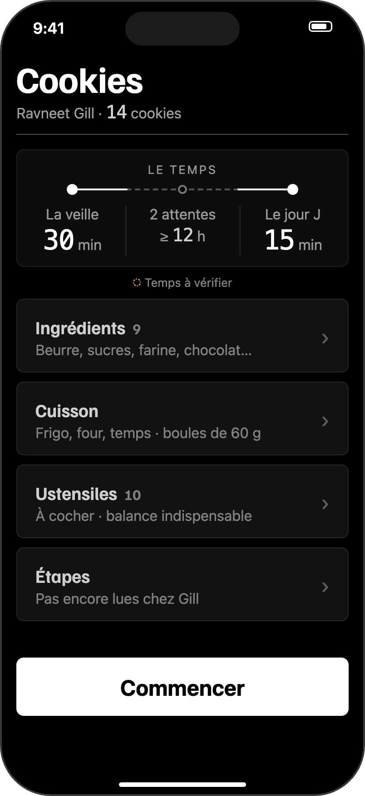

# Mes réalisations

Ce que je construis, une réalisation à la fois.

## MakaCook

**Ce que c'est :** une appli iPhone de cuisine, pensée pour tout le monde. Elle commence par les cookies.

**L'idée :** une seule recette sûre par plat, celle d'un chef reconnu et cité, au lieu d'une longue liste ; et chaque chiffre dit d'où il vient.

**Où ça en est (25/10/2026) :** en réflexion. Le style est bien avancé ; ce que fera la première version est en train d'être revu ; rien n'est encore codé.

**Outils :** Swift et Xcode ; Claude (une IA) comme prof : il conçoit et explique, je code.
